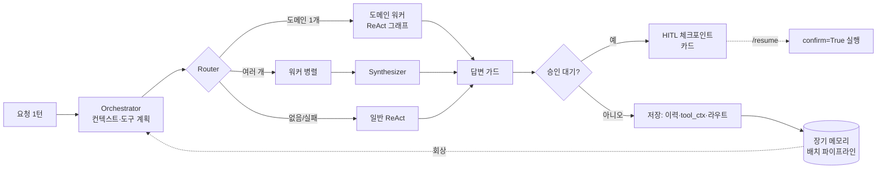

# Architecture

이 문서는 코드를 처음 읽는 사람을 위한 지도다. 무엇이 어디에 있고, 어떤 경계가 지켜져야 하는지를 적는다.
세부 규칙과 그 근거(실측·사고)는 [docs/rules/agent.md](docs/rules/agent.md) 와 [docs/rules/memory.md](docs/rules/memory.md) 에 있다.

**Architecture Invariant** 라고 표시한 문장은 코드가 지켜야 하는 불변식이다. 리뷰할 때 가장 먼저 볼 곳이다.
불변식은 "무엇이 있다"보다 "무엇이 없어야 한다"를 말하는 경우가 많다.

경로는 모두 `src/agent_arch/` 기준이다.

---

## Bird's Eye View

에이전트는 사용자의 한 턴을 받아 **도구를 골라 실행하고, 근거로 답하고, 비가역 행동은 사람 승인 뒤에만 실행하고,
대화에서 사용자에 대해 배운 것을 장기 기억으로 남긴다.**

입력은 텍스트 한 턴(+ 첨부)과 요청자 프로필(권한)이다. 출력은 스트리밍 답변, 승인 대기 카드, 그리고 저장소에 남는 기록이다.

세 개의 큰 흐름이 있다.

1. **턴 실행(동기)**: 오케스트레이터가 컨텍스트를 세우고, 라우터가 도메인을 고르고, 도메인 워커가 LangGraph ReAct 그래프로
   도구를 부른다. 답은 가드 체인을 지나 스트리밍된다.
2. **승인(비동기, 사람)**: 비가역 도구는 항상 초안만 만든다. 그래프가 interrupt 로 멈춰 체크포인트에 대기 항목을 남기고,
   사람이 카드에서 승인하면 `/resume` 이 그 항목을 `confirm=True` 로 한 번 실행한다.
3. **기억(배치)**: 턴 저장은 체크포인트 카운터만 올린다. 스케줄러가 쌓인 턴을 배치로 읽어 기억 단위(atom)를 뽑고,
   그 위에 장면·페르소나를 쓴다. 다음 턴이 시작될 때 회상이 이것들을 컨텍스트에 싣는다.

모델은 판단(무엇을 부를지, 어떻게 말할지)을 하고, 코드는 자원·권한·안전·사실성을 결정적으로 강제한다.
이 분업이 전체 설계를 관통한다.

---

## Entry Points

- **HTTP**: `main.py:create_app(setup=)` — 앱 조립부. `setup` 이 업무 도메인을 `extensions` 슬롯에 꽂는다.
  엔드포인트는 `api/v1/agent.py` 의 `POST /agent/run`·`/agent/stream`(SSE)·`/agent/{conversation_id}/resume`.
- **턴 처리**: `agents/orchestrator.py:AgentOrchestrator.run/stream`. 읽기 시작점으로 가장 좋다.
- **도구 루프**: `agents/graphs/react_graph.py:run_react_graph/stream_react_graph`(노드 정의는 `_build_react_graph`).
- **라우팅**: `agents/graphs/supervisor.py:run_supervisor/stream_supervisor`, `agents/graphs/router.py:route`.
- **승인**: `agents/hitl/graph.py:get_action_graph`, `agents/hitl/resume.py:resume_action`.
- **기억**: 쓰기 `services/memory_v2/capture.py:on_turn_saved` → `scheduler.MemoryV2Scheduler` → `pipeline.run_l1_job`
  → `layers.run_upper_layers`. 읽기 `services/memory_v2/recall.py:recall_for_turn`.
- **도메인 끼우기 예시**: `examples/helpdesk.py:install` — 처음 보는 사람은 여기부터 보면 확장 지점이 한눈에 들어온다.

---

## Code Map

### `main.py`, `core/`, `api/v1/`, `middleware/`, `queue/`

HTTP·기동 계층. `core/lifespan.py` 가 Redis·PostgreSQL·Qdrant·MCP 서버 등록·메모리 스케줄러를 순서대로 띄운다.
`core/config.py` 가 env 와 `config/*.yaml`(LLM 레인·도구 스위치·로깅)을 읽는다. `middleware/auth.py` 는 게이트웨이가 넣은
사용자 헤더를 요청 컨텍스트로 옮긴다. `queue/` 는 `/agent/run/async` 의 비동기 작업이다.

**Architecture Invariant:** 외부 의존이 없거나 실패해도 앱은 뜬다(단계별 상한, 경고만). `/health` 가 `degraded` 로 알린다.

**Architecture Invariant:** 비가역 실행의 HTTP 입구는 `/resume` 하나다. 승인 값으로 도구를 직접 실행하는 엔드포인트는 없다.

### `extensions.py`

업무 도메인이 코어에 끼어드는 모든 자리. 관문이 돌려줄 도메인 도구, 라우터 후보 여부, 승인 필요 도구·완료 문구·후처리,
사람 이름 해석, 디렉터리, 용어 사전 출처, 전용 채널 모드 프롬프트, 가이드 도구, 평가 저장소.

**Architecture Invariant:** 코어(`agents/`, `llm/`, `memory/`, `services/`)는 특정 업무 도메인을 import 하지 않는다.
슬롯이 비어 있으면 그 기능이 없는 것으로 결정적으로 동작한다(fail-closed).

### `agents/orchestrator.py`

한 턴의 지휘자. 요청 컨텍스트(사용자·프로필·대화 id·첨부·질문)를 ContextVar 로 세우고, 회상·용어·턴 컨텍스트로
메시지를 조립하고, 도구를 계획(`plan_tools`)하고, 실행 전략(ReAct / 가이드 루프 / 도구 미지원 직행)을 고른다.
결과를 저장하고 승인 대기 항목을 HITL 체크포인트에 적재한다.

**Architecture Invariant:** 턴마다 바뀌는 블록(날짜·요청자·위치·회상·규칙)은 시스템 프롬프트가 아니라 마지막 user 메시지
뒤에 붙는다. 시스템 프롬프트 + 도구 스키마는 전 사용자 공유 프리픽스다(프롬프트 캐시).

### `agents/graphs/`

LangGraph 로 표현한 실행 구조. `react_graph.py` 는 한 워커의 ReAct 루프(start → call_model → execute → … → answer),
`router.py` 는 도메인 선택(구조화 JSON), `supervisor.py` 는 워커 스코프·병렬 실행·합성, `checkpointer.py` 는 체크포인터 팩토리.

**Architecture Invariant:** 라우터 결과는 실패 / 없음(no_match) / 지정의 세 값이다. 직전 도메인 sticky 는 실패에서만 쓴다.

**Architecture Invariant:** ContextVar 는 LangGraph 노드 경계를 넘지 않는다. set 과 read 는 같은 노드에서, 넘겨야 하면 state 로.

**Architecture Invariant:** 병렬 워커는 각자 새 LLM·메시지 복사본을 쓰고, 한 워커의 예외는 그 워커만 제외한다.

**Architecture Invariant:** 라우터·supervisor 는 도메인 표를 매번 읽는다. import 시점에 굳히지 않는다(`register_domain`).

### `agents/react/`

그래프와 레거시 루프가 공유하는 부품. `executor.py`(도구 실행), `budget.py`(웹 중복·횟수·단계 상한),
`evidence_budget.py`(근거 총량 예산), `sufficiency.py`(충분성 판정 → 재검색), `verify.py`(답변 검증),
`provenance.py`(출처 각주), `link_policy.py`(근거 있는 링크만), `history.py`(라우터·검증기용 최근 대화).

**Architecture Invariant:** 코드는 자원(중복·횟수·근거량)만 제한한다. 무엇을 검색할지는 모델이 정한다.

### `agents/tools/`

도구의 출처(정적 스킬·MCP·동적 API)와 노출(core / retrieved / discoverable / sticky)을 분리한다. `exposure.py` 가 티어를,
`tool_search.py` 가 도메인 관문(`find_<domain>_tools`)과 `register_domain` 을, `mcp/` 가 원격 MCP 도구를 맡는다.

**Architecture Invariant:** core 에는 직접 호출 도구 대신 도메인 관문을 둔다. 관문이 발견한 도구는 같은 턴에 바인딩된다.

**Architecture Invariant:** 바인딩 목록 밖에서 꺼낸 도구(이름 폴백)도 권한 게이트를 다시 지난다.

### `agents/permissions/`

도구 호출 가능 여부를 판정하는 게이트(`gate.py:evaluate`). 권한 키는 `{service}.access` 단일 키가 기본이다.

**Architecture Invariant:** deny-by-default. 권한 메타가 없는 도구는 아무에게도 노출되지 않는다.

### `agents/hitl/`

비가역 액션 승인. `policy.py`(승인 필요 도구 레지스트리), `graph.py`(interrupt 미니그래프), `resume.py`(재개·락·`pending_id`
대조), `answer_guard.py`(없는 완료·없는 버튼 주장 교정), `followups.py`(완료 뒤 후속 제안).

**Architecture Invariant:** 승인 필요 도구는 플래그와 무관하게 항상 `confirm=False` 로만 실행된다. 실제 실행은 체크포인트에
남은 항목의 인자로, `pending_id` 가 맞을 때 한 번만 일어난다. 카드는 그 인자 그대로 그린다(카드 = 실행).

### `agents/prompts/`

시스템 프롬프트와 턴 컨텍스트 조립(`system.py:build_system_prompt/build_turn_context`). 도구 지침은 enabled 스위치에 따라
마커 치환으로 들어간다.

### `llm/`

자체 `BaseLLM` 추상과 프로바이더(Gemini·OpenAI·Anthropic·vLLM), 팩토리, 재시도(`transient.py`), 스트림 반복 붕괴 차단
(`runaway.py`), 외부 LLM 가명화(`pii/`).

**Architecture Invariant:** LangChain 모델로 감싸지 않는다. LangGraph 노드가 `BaseLLM` 을 직접 부른다.

**Architecture Invariant:** 재시도는 아직 토큰을 흘리지 않았을 때만, 다시 시도해서 살아나는 실패에만 한다.

**Architecture Invariant:** 가명화 매핑은 저장하지 않는다. 호출마다 만들고, 원본 메시지를 변형하지 않는다.

### `memory/`

대화 이력(Redis 리스트 + PostgreSQL 복원), 직전 도구 결과(tool_ctx), 직전 라우트, 압축(`compact_summary.py`).

**Architecture Invariant:** 이력 압축은 요약한 앞쪽 구간만 원자적으로 바꾼다. 요약이 점검을 통과하지 못하면 압축하지 않는다.

**Architecture Invariant:** 모델 원문(첨부가 붙은 입력)과 사용자가 직접 쓴 질문은 따로 저장된다. 제목·라우터·기억은 질문을 쓴다.

### `services/memory_v2/`

장기 기억. L0 원문 → L1 atom(persona/episodic/instruction/alias) → L2 장면 → L3 페르소나의 4층.
`capture`(턴 저장 훅) → `scheduler` → `pipeline`(추출 `extractor` → 판정 `dedup` → 쓰기 `writer`) → `layers`(장면·페르소나)
→ `recall`(안정 블록 + 턴 블록). `explicit` 은 저장·삭제 도구의 백엔드.

**Architecture Invariant:** 턴 경로에서 기억을 위해 LLM 을 부르지 않는다. 추출은 배치다.

**Architecture Invariant:** 매 턴 강제로 실리는 것은 사용자가 명시로 `scope=always` 저장한 지시뿐이다. 나머지는 관련도로 회상된다.

**Architecture Invariant:** 승인하지 않은 초안, 시스템이 이미 가진 값(기록 시스템 자기조회), 실시간 값은 기억이 되지 않는다.

### `services/`

그 밖의 지원 서비스. `web/`(웹 검색 가드·출력 정규화), `glossary.py`(용어 사전 교정), `api_registry/`(도구 색인),
`usage/`(벤더 경계 비용 계측), `monitoring/`(오류 이벤트), `langsmith/`(관측·피드백).

### `examples/`

`helpdesk.py` — 코어 수정 없이 업무 도메인 하나를 끼우는 본보기. 조회 2 + 승인 필요 1 도구, 모든 슬롯 사용.

---

## Cross-Cutting Concerns

### 요청 컨텍스트

사용자·프로필·대화 id·첨부·질문·발견 도구는 ContextVar 로 흐른다(`agents/context.py`). `asyncio.gather` 는 자식 Task 에
컨텍스트를 **복사**하고 LangGraph 는 노드마다 격리한다. 경계를 넘어야 하는 값은 리스트·dict 를 제자리 수정하거나 state 로 넘긴다.
병렬 워커 간 격리는 이 복사 성질을 이용한다.

### 안전과 권한

세 겹이다. 노출(관문·티어) → 실행 권한(게이트) → 비가역 승인(HITL). 노출됐다고 실행 권한이 있는 것이 아니고,
실행 권한이 있어도 비가역 행동은 사람 승인을 거친다. 답변 쪽에서는 없는 완료·없는 버튼·근거 없는 링크·근거 없는 이름을
코드가 교정한다.

### 결정적 가드 vs 확률적 지시

모델이 지시를 안 따를 때 정규식 의도 감지·도구 강제로 덧대지 않는다. 주입 위치·프레이밍·구조(관문, 레인 분리, 슬롯)로
푼다. 코드가 강제하는 것은 출력의 사실성(링크·이름·완료 주장·표기)과 자원·권한·안전이다
([agent.md 13절](docs/rules/agent.md)).

### 취소

`agents/run_registry.py`(사용자별 run) + `agents/cancellation.py`. 루프와 그래프는 토큰 단위·도구 실행 직전에 확인하고
`stopped` 로 끝낸다. 부분 답변은 보존한다.

### 실패와 저하

외부 의존 실패는 기능 저하로 흡수한다: 인덱스가 죽어도 관문은 확장 도구를 돌려주고, 검증기·충분성 판정기·용어 사전·
회상 실패는 "없음"으로 떨어진다. 사용자에게 보이는 실패는 모델 호출 자체가 끝까지 안 될 때뿐이다.

### 프롬프트 캐시

시스템 프롬프트 + 도구 스키마는 전 사용자 공유 프리픽스로 유지한다. 가변 블록은 전부 마지막 user 뒤로 간다.
답변 언어 렌더도 기본 언어에서는 이관 전과 바이트가 같아야 한다.

### 관측

LangSmith(관측)와 LangGraph(오케스트레이션)는 다른 층이다. 그래프 노드 계측(`_instrument`)이 노드 경로·시간·LLM 호출 수·
검증 결과를 run 메타와 메시지 metadata 에 함께 남긴다. 비용은 벤더 SDK 를 부르는 자리에서 센다(`services/usage/meter.py`).

### 멀티테넌시

격리 단위는 사용자(sub)이고 회사 범위가 그 위에 얹힌다. 기억·이력 조회는 SQL·벡터 필터에서 사용자로 강제한다.

### 설정

env(`core/config.py`)와 `config/*.yaml`. 새 동작은 `off | shadow | on` 3단 플래그로 들어와, shadow 로 판정을 모은 뒤 켠다
(답변 검증·메모리 v2 등).

### 테스트

`tests/` 는 외부 인프라 없이 돈다. LLM 은 대본(stream 이벤트 목록)으로 대신하고, Redis Lua 는 `fakeredis[lua]` 로 실제 Lua 를
돌린다. 그래프 이관은 패리티 테스트(같은 입력에 같은 이벤트·결과)로 지킨다. 라우팅 변경은 실제 LLM 재생 평가로 판정하고,
결과가 흔들리므로 한 번으로 판정하지 않는다. 끝까지 도는 본보기는 `tests/examples/test_helpdesk_example.py`.
