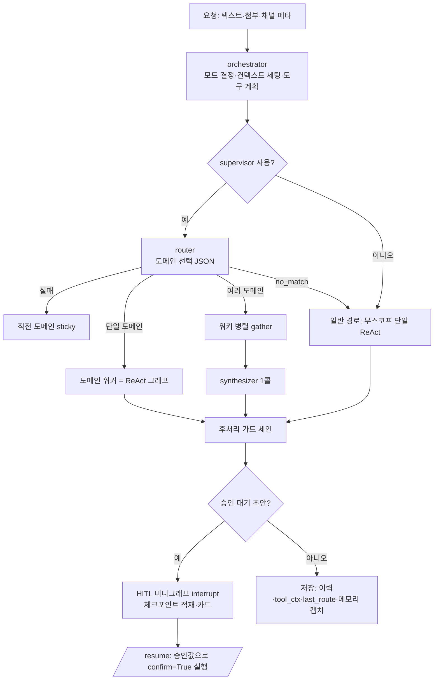

# 에이전트 아키텍처 규칙

업무 에이전트(메신저·메일·일정·결재·구매·물류 같은 업무 도메인 + 웹 검색)의 설계 규칙이다.
각 규칙은 **규칙 / 왜 / 어떻게** 로 적는다. "왜"는 실제 장애·실측에서 나왔고, "어떻게"는 이 레포 코드 위치를 가리킨다.
경로는 `src/agent_arch/` 기준이다.

장기 메모리는 [memory.md](memory.md)에 따로 정리했다.

---

## 0. 전체 흐름

**ReAct 그래프 노드** (`agents/graphs/react_graph.py:_build_react_graph`)
- start → loop_guard → call_model → (execute | verify | answer | retry_any | malformed | fallback | salvage | stopped)
- execute → auto_fetch → sufficiency → loop_guard 로 되돌아간다.
- verify → answer | loop_guard(보강 재루프) | rewrite.
- 종료 노드: answer, fallback, malformed, force_answer, salvage, stopped.

---

## 1. 코어와 도메인을 분리한다

**규칙**: 에이전트 코어(라우터·관문·HITL·오케스트레이터·PII)는 특정 업무 도메인 모듈을 import 하지 않는다. 도메인이 끼어들 자리는 확장 슬롯으로 연다.
- **왜**: 코어가 구매·물류·예약·용어 사전·사내 디렉터리 모듈을 직접 import 하면, 도메인 하나를 끄거나 바꿀 때마다 코어 네 곳을 같이 고쳐야 하고 도메인 차단 누락이 사고로 이어진다(4.6절).
- **어떻게**: `extensions.py` 의 `Extensions` 슬롯을 쓴다. 슬롯이 비어 있으면 코어는 "그 기능 없음"으로 결정적으로 동작한다(fail-closed).
  - `domain_tools` / `domain_available`: 인덱스 밖 도메인 도구와 라우터 후보 여부
  - `post_approval`: 승인 실행 뒤 도메인 후처리(연쇄 생성·팀 알림). 실패해도 본 액션 결과는 유지한다.
  - `person_resolver`: MCP 도구 인자의 사람 이름 → 계정 해석
  - `directory_client`: PII 가드 어휘 출처
  - `glossary_source`: 용어 사전 출처. 캐시·매칭·교정은 `services/glossary.py` 가 한다.
  - `mode_prompts`, `guide_tool`: 전용 채널 모드 프롬프트, 가이드 지식베이스 도구
  - `approval_required`, `action_done_messages`: 업무 도메인의 승인 필요 도구와 완료 문구. 코어 승인 목록은 협업 도메인(일정·메일·메신저·HR) 쓰기 도구만 갖는다.
  - `followup_builders`: 승인 완료 뒤 후속 제안 빌더
  - `always_action_domains`, `domain_addenda`: 늘 실행 질의로 보낼 도메인, 도메인별 워커 지침
  - `eval_sink`: 병렬(그림자) 평가 결과 저장소

---

## 2. 요청 컨텍스트와 동시성

**규칙**: 요청 스코프 값(사용자·프로필·대화 id·첨부·발견 도구)은 ContextVar 로 전달하되, ContextVar 가 경계를 넘는 지점을 안다.
- **왜**: 두 번 크게 깨졌다.
  - `asyncio.gather` 는 자식 Task 에 context 를 **복사**한다. 자식 도구가 `_discovered.set()` 해도 부모 루프로 안 올라와서, 탐색으로 찾은 도구가 바인딩되지 않고 `tool NOT FOUND` 가 났다.
  - LangGraph 는 노드마다 `copy_context` 로 격리한다. start 노드의 reset 과 execute 노드의 drain 이 갈라져서 탐색 도구가 전량 유실됐다. mock 패리티 테스트로는 안 잡히고 실측에서만 잡혔다.
- **어떻게**:
  - 경계를 넘길 값은 리스트 **in-place 변경**(extend/clear)으로 넘긴다(`agents/tools/tool_search.py:reset_discovered_tools/drain_discovered_tools`).
  - set 과 read 는 같은 노드에 co-locate 한다. reset → execute_tools → drain 을 execute 노드 하나에 묶었다.
  - 노드 경계를 넘어야 하는 값은 state 로 넘긴다.
  - 병렬 워커 간 격리는 이 복사 성질을 **이용**한다(3.6절).

**규칙**: 실행 중 취소는 협조적으로 한다.
- **어떻게**: `agents/run_registry.py:register_run`(사용자별 run id + Event)과 `agents/cancellation.py:is_cancelled` 를 루프·그래프가 확인하고, `stopped` 노드로 끝낸다.

**규칙**: 진입 경로 메타(게이트웨이가 주는 원래 화면 경로)로 모드 기본값을 정한다. 명시값이 항상 이긴다.
- **어떻게**: `agents/source_routing.py`. 우선순위는 Form 명시값 > 경로 매핑 > 설정 기본값이다.

---

## 3. 라우팅과 감독(supervisor)

### 3.1 구조
**규칙**: 단일 ReAct 에 도구를 평면 바인딩하지 말고 라우터 → 도메인 스코프 워커 → 합성으로 나눈다. 라우터는 도메인을 거칠게(coarse) 고르기만 하고, 도구는 워커 안에서 2단 검색으로 고른다.
- **왜**: 도구 300개 가까이를 평면 바인딩하면 모델이 헤매고 비싸다. 다만 관문 도구(4절)가 이미 2단 노출이라 단일 도메인에서는 라우터 1콜과 관문 왕복이 비슷하다. 라우터의 실가치는 **병렬**과 **제어 지점**이다.
- **어떻게**: `agents/graphs/router.py:route`(구조화 JSON 출력, 도구 미바인딩), `agents/graphs/supervisor.py:run_supervisor/stream_supervisor`. 핸드오프-as-tool 방식은 기각했다(동적 감독이라 제어 지점이 흐려진다).

**규칙**: 라우터 LLM 은 도구가 바인딩되지 않은 새 인스턴스를 쓴다. 가능하면 경량·안정 레인으로 분리한다.
- **왜**: 메인 LLM 은 이미 도구가 바인딩돼 있어 JSON 대신 도구를 호출한다. 메인 프로바이더가 과부하(503)면 라우터까지 같이 죽는다. thinking 이 max_tokens 를 다 써서 빈 응답이 나온 적도 있다.

### 3.2 라우터 결과는 세 값이다: 실패 / 없음 / 지정
**규칙**: "해당 도메인 없음(no_match)"을 실패로 뭉개지 않는다. no_match 는 무스코프 일반 경로로 보내고, 직전 도메인 sticky 는 **실패에서만** 쓴다.
- **왜**: 결재 직후 "너는 뭘 할 수 있지?"에 라우터가 정답 `domains=[]` 를 냈다. 그런데 파서가 이를 None(실패)으로 바꿔 직전 결재 도메인으로 sticky 됐고, 결재 워커가 자기 기능만 소개했다. 재생 평가 10/12 → 12/12.
- **어떻게**: `router.py:parse_route` 가 명시 `domains=[]` + 비후속이면 `RoutePlan(no_match=True)` 를 돌려준다. 깨진 JSON과 전부 걸러진 도메인만 None 이다. `supervisor._decide` 가 no_match 면 일반 경로로 보낸다. 예외는 진행 중인 초안이 있을 때뿐이다.
- 라우터 프롬프트의 "단서 없으면 직전 도메인 유지" 규칙은 **참조·후속 질의에만** 적용한다. 새 요청에 맞는 도메인이 없으면 `domains=[]` 를 명시하게 한다.

### 3.3 후속 질의: 직전 도메인은 힌트다
**규칙**: 후속 질의면 직전 **실행** 도메인을 상속하되, 라우터가 이번 턴에 이용 가능한 다른 도메인을 높은 확신(0.85 이상)으로 고르면 라우터를 따른다.
- **왜**: 두 방향으로 모두 실패했다.
  - 상속이 없을 때: "그 중 제일 큰 건?"에서 라우터가 punt 했다.
  - 상속이 무조건일 때: 웹을 끈 턴이 메모리 도메인으로 처리된 뒤 웹을 켜도, 라우터의 web 판단(0.95~1.00)을 매번 memory 가 덮어써서 "웹 검색 불가"라고 답했다.
  - 0.85 는 오분류 사례(0.70)와 정답 사례(0.95) 사이에서 정했다.
  - 공개 레퍼런스(대화 상태 추적, 컨텍스트 수명)의 공통 원칙도 같다: 앞 맥락은 힌트, 이번 턴 명시가 우선, 기능은 매 턴 재계산.
- **어떻게**: `RoutePlan.follow_up`, `supervisor` 의 `router_followup_override_confidence`, `memory/conversation.py:save_last_route/load_last_route`. 폴백 턴은 `[]` 로 저장한다.

**규칙**: 라우터에도 최근 대화를 준다.
- **왜**: 앞 턴이 연구 주제였는데 "Kim 관련된거 찾아봐"를 라우터가 이번 문장만 보고 판단했다. 그 결과 메신저·메일·드라이브·인사 4도메인으로 팬아웃했고 LLM 16회·34만 토큰을 썼다. 대화 이력을 못 받는 판단 지점은 라우터뿐이었다.
- **어떻게**: `agents/react/history.py:recent_history`(기본 3턴·600자)를 라우터 user 메시지에 [최근 대화]로 넣는다. 검증기도 같은 함수를 쓴다.

**규칙**: 개인화 신호(기억의 별칭 등)는 라우터에 **힌트 한 줄**로만 준다. 직전 도메인이나 sticky 대상으로 쓰지 않는다.
- **왜**: 직전 턴에 도구가 없을 때 기억 별칭 도메인을 "직전 대화 도메인"으로 표기했더니, punt 시 그 도메인으로 강제 배정됐다.
- **어떻게**: 별칭 도메인을 분리해 `route(alias_domain=)` 로 넘기고, user 메시지에 "[사용자 별칭 사전]" 한 줄로만 넣는다.

### 3.4 워커 입력: 서브쿼리 vs 원문
**규칙**: 도메인이 하나뿐이면 워커에 원문을 그대로 준다. 여러 도메인이면 워커의 마지막 user 메시지를 그 도메인 서브쿼리로 바꾼다. 어느 경우든 턴 컨텍스트 블록은 통째로 이월한다.
- **왜**:
  - 멀티 도메인 워커가 전체 요청을 받으면 남의 도메인 관문을 호출했다.
  - 단일 도메인인데 라우터가 다시 쓴 서브쿼리를 받으면, 요청 뒷부분("…그리고 내 이름 넣어 한 줄")이 떨어졌다.
  - user 를 교체하면서 턴 컨텍스트(요청자·위치·안정 기억·용어·웹 꺼짐 고지)가 통째로 사라진 결함도 있었다.
- **어떻게**: `supervisor.py:_scope_messages`. `_TURN_CONTEXT_HEADER` 이후 블록을 이월한다(`agents/prompts/system.py:1775`).

### 3.5 워커 도구 공급
**규칙**: 워커에도 도메인 무관 글로벌 유틸리티(계산기·사람 찾기 등)와 그 도메인의 sticky 도구를 준다. 다만 워커 실행 여부는 **도메인 도구 유무로만** 정한다.
- **왜**: 라우터 경로를 얹으면서 모놀리식 경로가 늘 주던 core 글로벌 도구가 워커에서 빠졌다. "김철수한테 메일"에서 수신자를 해석하지 못했다.
  - 반대로 글로벌 도구만으로 도구 없는 도메인을 억지 실행하면 안 된다.
- **어떻게**: `router.py:is_domainless_utility/select_global_tools`, `supervisor._merge_tools`(이름 dedup), `_domain_sticky`(도메인별 필터로 교차 오염 방지). 메신저 첨부 읽기 같은 도메인 횡단 읽기 도구는 `CROSS_DOMAIN_READERS` 로 둔다.

### 3.6 병렬 워커 정확성 3요건
**규칙**: 병렬 워커는 ① 워커마다 새 LLM 인스턴스 ② 워커마다 메시지 리스트 복사본 ③ gather 의 context 복사로 ContextVar 격리. 셋 다 지킨다. 합성 전에는 `bind_tools([])` 를 한다.
- **왜**: `bind_tools` 레이스와 병렬 append 오염 때문이다. 발견 도구 큐가 워커 간에 섞이지 않는 것은 테스트로 실측했다.

### 3.7 합성은 승인 대기를 지운다
**규칙**: 승인 대기 초안을 가진 워커가 있으면 합성을 건너뛰고 pending 큐를 합쳐 돌려준다.
- **왜**: 메일+일정 요청에서 메일 워커의 초안 큐를 합성이 버렸다. 그래서 카드는 떴는데 /resume 이 409(체크포인트 없음)였다.
- **어떻게**: `supervisor.py:_collect_pending/_merge_pending`.

---

## 4. 도구 노출

### 4.1 출처와 노출을 분리한다
**규칙**: 도구가 어디서 왔는지(정적 스킬·MCP·동적 API)와 어떻게 노출할지는 별개 축이다. 노출은 티어로 선언한다.
- **티어**:
  - **core**: 상시 바인딩. 정원은 약 15개이고 넘으면 경고한다.
  - **retrieved**: 질의 검색으로 붙는다.
  - **discoverable**: 관문 도구가 찾아 같은 턴에 바인딩한다.
  - **sticky**: 직전 턴 도구를 유지한다.
- **어떻게**: `agents/tools/exposure.py:Exposure/core_tools/plan_tools`. 우선순위는 설정 yaml > 클래스 `exposure` > 기본값이다.

### 4.2 도메인별 관문(탐색 도구)
**규칙**: core 에는 직접 호출 도구 대신 도메인별 탐색 도구 `find_<domain>_tools` 를 상시 둔다. 범용 tool_search 와 passive 사전 검색 덤프는 두지 않는다.
- **왜**: 이름이 곧 의도라서 경량 모델도 정확히 호출한다. 잡탕 사전 검색 덤프와 루프 중간 자동 재검색은 노이즈였다. 모델이 헤맸고 탐색 도구가 무용지물이 됐다.
- **어떻게**: `agents/tools/tool_search.py:_DOMAIN_TOOLS`. 발견하면 `_discovered` 큐에 넣고, 루프가 iteration 끝에 drain → merge → rebind 해서 같은 턴에 네이티브로 호출한다. 텍스트 tool_call 프록시는 vLLM 인자 조립 위험으로 기각했다.
- 관문은 인덱스 밖 도메인 도구(기능 플래그·요청 단위 opt-in)도 결정적으로 돌려준다(`extensions.domain_tools`). 모델이 관문을 먼저 불러도 빈손이 되지 않는다.
- 권한으로 전부 가려지면 "기능 없음"과 "권한 없음"을 구분해 알린다. 인덱스 검색에는 관련성 임계값이 없으므로 히트를 "맞는 도구"로 단정하지 않는다.

### 4.3 sticky 는 "호출된" 도구만 살리면 안 된다
**규칙**: 후속 턴 바인딩에는 직전 턴에 **호출된** 조회 도구만이 아니라 그 도메인의 **실행 도구**도 다시 닿을 수 있어야 한다. 그리고 대상(직전 결과)은 무도구 턴에도 유지한다.
- **왜**: 조회 → "진행중으로 바꿔줘" → 봇이 식별자를 되물었다 → "방금 것" → 완전히 망각했다. 원인은 두 겹이었다.
  - ① sticky 가 직전에 호출된 조회 도구만 되살려서 상태 변경 도구가 바인딩되지 않았다.
  - ② 무도구 턴(되묻기)에서 tool_ctx 를 지워 대상 id 가 사라졌다.
  - 능력이 없던 게 아니다. 같은 증상이 메일("방금 그거 요약해줘" → UID 되묻기)에서도 재현됐다.
- **어떻게**: 단일 도메인 전용 채널은 그 도메인 도구를 전부 직접 바인딩하고, 관문은 fallback 으로 둔다. `memory/conversation.py:append_turn` 은 무도구 턴에서 tool_ctx 를 지우지 않고 TTL 만 갱신한다. 프롬프트에는 "후속 지시는 직전 결과의 식별자를 그대로 쓰고, 도구가 없으면 find_*_tools 를 먼저 부른다"를 둔다.
- 실패는 3층으로 나눠 본다: ① 컨텍스트(대상 데이터) ② 도구(실행 능력) ③ 행동(되묻기 vs 실행). 도구를 쥐어 주는 것은 ②만 고친다.

### 4.4 통합 인덱싱
**규칙**: 소스가 다른 도구도 하나의 벡터 컬렉션에서 랭킹한다. 등록 도구는 이름+설명만 색인하고, 히트하면 레지스트리에서 실물로 resolve 한다.
- **왜**: 소스마다 노출 방식이 강제되면 소스를 가로지르는 랭킹이 안 된다. 실물 resolve 를 하면 권한이 이중으로 등록될 수 없다.
- **어떻게**: `services/api_registry/`(models·loader·indexer·registry_loader).

### 4.5 동적 API 도구
**규칙**: 외부 API 명세 기반 도구는 선언(JSON)으로 등록하고 enabled 인 것만 레지스트리에 올린다. 꺼진 항목은 인덱스에서 고아 포인트를 정리한다.
- **어떻게**: `agents/tools/dynamic_api_tool.py`, `services/api_registry/loader.py`.

### 4.6 도메인 하나를 완전히 끄려면 네 층을 다 끈다
**규칙**: 실행 경로와 **능력 광고** 경로는 별개다. 도메인을 차단할 때는 둘 다 끈다.
- **네 층**: ① 동적 도구 enabled ② 관문 `find_<domain>_tools`(마스터 스위치)와 그 도메인 스킬의 enabled ③ 시스템 프롬프트의 도메인 라우팅 줄·사용 원칙 절·폴백 문구·형식 예시 ④ (선택) 관문 등록 코드
- **왜**: 도구 JSON 만 끄면 실행은 막히지만 에이전트는 계속 "그 기능 됩니다"라고 한 뒤 "도구 없음"으로 실패했다.
- **함정**: 누가 설정 항목을 stale 로 보고 지우면 기본값 enabled 로 되살아난다. 주석으로 의도를 남긴다.
- 특정 채널에서만 도메인을 열 때는 관문 전역 OFF 를 유지하고 그 진입점에서만 런타임 주입한다(fail-closed).

### 4.7 도구 스키마 위생
**규칙**: 모든 도구 스키마를 모든 프로바이더 기준으로 검증한다. 특히 `type: array` 에는 반드시 `items` 를 넣는다.
- **왜**: 도구 16개 중 1개가 `items` 없는 배열이었다. Gemini 가 요청 **전체**를 400으로 거부했고 사용자는 빈 답을 받았다. OpenAI 호환(vLLM) 경로는 검증하지 않아 기본 경로에서는 잠복했다. 결정적 스키마 오류에는 "ANY 재시도"가 무의미하게 두 번 찍힌다.
- **어떻게**: 등록된 전 도구를 순회하는 스키마 테스트를 둔다. `llm/gemini.py:_clean_schema_property` 에서 방어적으로 정규화한다. 원격 MCP 도구는 `remote_tool._sanitize_parameters` 에서 정리한다.
- 로그 진단 팁: 워커 도구 목록 로그의 순서가 `function_declarations[N]` 인덱스와 같다.

---

## 5. 도구 실행

**규칙**: 도구 호출은 공유 실행기 하나를 거친다. 그래프와 옛 루프가 같은 실행기를 쓴다.
- **어떻게**: `agents/react/executor.py:execute_tools`. 병렬 실행 후 LLM 메시지 형식으로 직렬화한다.

**규칙**: 가명화 자리표시 토큰이 인자에 남아 있으면 실행하지 않는다.
- **어떻게**: `executor.py:unresolved_placeholder_error`. HITL resume 도 같은 검사를 한다(`agents/hitl/graph.py:_execute_one`). resume 은 executor 를 거치지 않기 때문이다.

**규칙**: 웹 도구는 코드가 **자원**(중복·횟수·단계)만 제한한다. 무엇을 검색할지는 모델이 정한다.
- **왜**: 한 턴에 웹 검색 14회(같은 검색어 3~4종을 3~4번 반복)·LLM 26회·69.5만 토큰을 쓴 사례가 있었다. 횟수 상한만 두니 모델이 스텝마다 하나씩 8번을 순차로 불렀다(LLM 11회·스텝당 5만 토큰 재전송).
- **어떻게**: `agents/react/budget.py:WebGuard`
  - 같은 도구+같은 인자를 다시 부르면 "앞선 결과를 보라"는 구조화 오류를 돌려준다(앞선 호출이 오류였으면 재시도 허용).
  - 턴당 호출 상한은 기본 8이다.
  - 웹을 부른 스텝 수 상한은 기본 3이다. 한 스텝 안의 병렬 호출은 1로 센다. 그래서 넓게 병렬로 부르는 쪽이 유리하다.
  - 사내 도구는 대상이 아니다. 상태를 바꾼 뒤 다시 읽는 반복은 정상이기 때문이다.

**규칙**: "더 찾아라"는 모델 성향에 맡기지 말고 **충분성 판정 → 재검색 → 예산 소진 시 있는 근거로 답** 루프로 코드가 보장한다.
- **왜**: "오늘 유로 기준환율"에서 첫 검색 결과에 공식 수치가 없었는데 모델이 더 찾지 않고 "확인되지 않는다"고 답했다. 지침·도구 결과 안내·사후 검증기 어디에 넣어도 소극적인 모델은 따르지 않았다.
- **어떻게**: `agents/react/sufficiency.py`. 한 라운드는 판정 LLM 1회(경량, 도구 없음)와, 부족할 때 새 검색어 3개 이하·URL 2개 이하의 병렬 실행이다. 기본 2라운드.

**규칙**: 더 찾게 하는 장치들이 겹쳐도 컨텍스트를 넘지 않게 턴 근거 총량 예산을 둔다. 줄일 때는 결정론적으로 자른다.
- **왜**: 선실행 검색 + 충분성 2라운드 + 검증기 보강이 겹쳐 검색 13건(건당 약 2만 자)·페이지 8건이 쌓였다. 65k 창을 넘겨 빈 응답으로 끝났다. 근거를 가장 많이 모은 턴이 가장 나쁘게 끝났다.
- **어떻게**: `agents/react/evidence_budget.py`. 예산의 몇 배를 넘으면 더 찾지 않는다(`over_budget`). 모델 호출 전 `compact` 로 JSON 구조를 유지한 채 큰 결과부터 공통 상한으로 자른다. 확률적 요약은 쓰지 않는다. 공유 Message 를 제자리 수정하지 말고 교체한다.

**규칙**: 같은 실패가 반복되면 끊는다.
- **어떻게**: `react_graph.py:_failure_signature`, `_MAX_SAME_FAILURES = 3` → force_answer. 빈 스코프 검색은 넓혀 다시 찾는다(`_widen_empty_scoped/_widen_empty_linked`).

**규칙**: 바인딩 목록 밖에서 도구를 꺼내는 폴백(`find_tool`)도 권한 게이트를 다시 거친다. 막히면 NOT FOUND 로 돌려 모델이 관문으로 정상 발견하게 둔다.
- **왜**: 폴백이 게이트를 건너뛰어, 모델이 이름만 알면 권한 없는 도구를 실행할 수 있었다.
- **어떻게**: `agents/react/executor.py:find_tool`.

---

## 6. 권한 게이트

**규칙**: 도구 호출 가능 여부는 코드 게이트가 deny-by-default 로 판정한다. 메타가 없는 도구는 거부한다.
- **어떻게**: `agents/permissions/gate.py:evaluate`. 평가 순서:
  1. 메타 없음 → deny
  2. 프로필 없음 → deny
  3. 게스트 → `allow_guest` 만 통과
  4. PUBLIC → 통과
  5. `"{svc}.access"` 1차 게이트(`services_any` 는 OR)
  6. 모드별 평가(PERMISSION/ROLE/SERVICE_ADMIN/ACCESS_ONLY)
- **규칙**: 권한 키는 `{svc}.access` 단일 키로 단순화하고, 세분 권한은 필요한 항목만 수동 지정한다.
  - **왜**: ID 공급자가 거친 키만 발급하는데 도구 메타가 세분 키를 요구했다. 그래서 한 도메인 도구 241개가 전부 deny 됐다.
- **규칙**: 노출과 실행 권한은 다르다. 도구를 직접 바인딩해도 게이트는 그대로 적용한다. 관문 안 검색 결과도 프로필로 다시 거른다. 루프 중간 재검색이 게이트를 우회하던 구멍이 있었다.

---

## 7. MCP 원격 도구

**규칙**: 원격 MCP 도구는 서비스 토큰과 사용자 컨텍스트 묶음 헤더로 호출한다. 서버마다 필요한 헤더만 골라 쓴다(메일함 식별 이메일·게이트웨이 세션 id 등).
- **어떻게**: `agents/tools/mcp/transport.py:open_mcp_session/user_context_headers`, `remote_tool.py`, `provider.py`.
- **함정**: MCP SDK 2.x 는 HTTP 클라이언트로 `httpx2` 를 쓴다. `httpx.AsyncClient` 를 넘기면 **예외 없이 조용히 열화**한다(서버발 메시지가 도착하지 않음). 이 파일만 httpx2 를 쓴다.

**규칙**: 자격증명을 에이전트에 저장하지 않는다. 사용자 세션을 패스스루하고, 세션 콜백은 서버가 실제로 도달 가능한 공개 엣지 주소로 한다.
- **왜**: 내부 주소 override 가 오래된 로컬 게이트웨이로 보내져 `SESSION_NOT_FOUND` 가 났다.

**규칙**: 서버 도구 목록의 버전 불일치(skew)를 기동 시 판정하고 다시 묻는다.
- **왜**: 백엔드가 MCP 서버보다 1분 먼저 떠서 **옛 목록을 성공적으로** 받았다. 성공했으니 재시도가 돌지 않았다. 모델은 새 도구를 정확히 골랐지만 `tool NOT FOUND` 로 튕겼다. 조용한 고장이었다.
- **어떻게**: `agents/tools/mcp/skew.py`. 정책표에 있는 이름이 서버 목록에도 없고 로컬에도 없으면 불일치로 본다. 판정을 분리해 둔 이유는 MCP 전송 계층 없이도 테스트하기 위해서다.

**규칙**: MCP 도구는 정책표(권한+노출)에 있어야 붙는다. 정책 매핑이 없는 도구는 건너뛰고 로그를 남긴다.
- **어떻게**: `provider.py` 의 정책표, `remote_tool._sanitize_parameters`.

**규칙**: 사람 이름 인자는 디렉터리로 실제 계정을 확정한 뒤 호출한다. 모호하면 원격 호출 없이 되묻기 결과를 돌려준다.
- **어떻게**: `extensions.person_resolver`.

---

## 8. HITL: 비가역 액션 승인

### 8.1 승인은 코드가 강제한다
**규칙**: 비가역 액션(발송·등록·삭제·상신 등)의 승인 여부는 프롬프트가 아니라 **코드 레지스트리**로 정하고, 비승인 턴에서는 `confirm=False`(초안)만 실행되게 강제한다.
- **왜**: 승인 흐름이 도구 설명과 프롬프트로만 관리될 때 LLM 이 초안을 건너뛰고 첫 호출부터 `confirm=true` 로 실행했다. 카드가 뜰 틈도 없이 전송됐다. 확률적이라 "가끔" 일어났다.
- **어떻게**: `agents/hitl/policy.py`(승인 필요 도구 집합 = 커밋 엔드포인트 매핑과 1:1). 그래프 실행 노드가 confirm 을 강제 false 로 하고, 초안이면 `pending_action` 을 세팅하고 턴을 끝낸다.
- **함정**: 게이트가 기능 플래그에만 의존하면 플래그 기본값이 꺼진 환경에서 무방비가 된다. 그래서 강제에는 플래그가 없다(그래프·루프 모두 항상 confirm=False, 체크포인트도 항상 적재).

### 8.2 interrupt + checkpoint + resume
**규칙**: 전체 루프를 옮기지 말고 **액션 실행 지점만** LangGraph 미니그래프로 감싼다. `interrupt(draft)` 로 멈추고, `/resume` 이 `Command(resume=values)` 로 이어 실행한다. 실행할 도구는 체크포인트 state 에서만 읽는다.
- **왜**: 위조 불가(클라이언트가 도구·인자를 바꿀 수 없음)와 최소 변경을 함께 얻는다. 추론 노드가 없어 메시지 어댑터가 필요 없다.
- **어떻게**: `agents/hitl/graph.py:get_action_graph`, `resume.py:load_pending/validate_resume_values/resume_action`(화이트리스트 검증, `pending_id` 대조 — 다르거나 빠지면 `StalePendingAction`).

**규칙**: 체크포인터는 단일 주입 지점 팩토리로 둔다. 단일 워커면 메모리로 시작하고, 멀티 워커·재배포 생존이 필요해지면 Postgres 로 바꾼다.
- **왜**: 바닐라 Redis 는 공식 Redis 체크포인터(모듈 요구)를 못 쓴다. 메모리 saver 는 재배포·다중 파드에서 승인 대기 초안을 잃는다.
- **어떻게**: `agents/graphs/checkpointer.py:get_checkpointer`.

**규칙**: 같은 대화의 승인 재개는 한 번에 하나만 통과시킨다.
- **왜**: 메신저 카드는 콜백 응답 전까지 버튼이 살아 있다. 1초 간격 두 번 클릭이 같은 interrupt 를 통과해 DM 이 두 번 나갔다.
- **어떻게**: `resume.py:resume_guard`(Redis 락 + 로컬 락 대비책).

### 8.3 카드와 실행의 대응
**규칙**: 대기 항목마다 `pending_id` 를 부여해 카드(버튼 서명)에 싣고, 콜백·정산 단계에서 불일치면 거부한다. 새 카드를 게시하면 앞 카드를 "대체됨"으로 표시한다.
- **왜**: 버튼 context 에 대화 id 만 있었다. 대화의 "현재" 대기 항목을 실행했기 때문에 **앞 카드 버튼이 새 값으로 실행**됐다. 앞 카드는 '처리 중'에 고착되고 새 카드는 "이미 처리된 요청"이 됐다.
- 버튼 메타에서 이미 다른 뜻으로 쓰는 키(approve/reject 의 action_id 등)는 재사용하지 않는다.

**규칙**: **카드 = 실행** 불변식. 카드는 승인 시 재실행될 바로 그 인자로 그린다.
- **왜**: 카드는 병합값으로 그리고 승인은 원 호출 인자로 재실행하니, 둘이 다를 때 다른 초안이 생기고 첨부가 누락됐다.

### 8.4 멀티 액션과 이어 하기(continuation)
**규칙**: 한 요청의 여러 액션은 큐로 하나씩 승인·실행한다. 큐가 비면 한 턴 더 돌려(continuation) 다음 액션을 계획한다.
- **어떻게**: 그래프 노드당 1건과 조건부 엣지 순회로 이중 실행을 막는다. 실행 결과는 이력에 평문 확인 메시지로 남겨 continuation 이 한 일을 알게 한다.
- **규칙**: continuation 은 **원 턴과 같은 프로바이더**로 돌린다. 직전 메시지의 프로바이더를 저장소에서 복구한다.
  - **왜**: 서버 기본 프로바이더로 돌아 사용자가 고른 모델이 무시됐다. 멀티 액션이 첫 액션만 하고 끝났다.
- **규칙**: 거절이면 continuation 에 진입하지 않는다.
  - **왜**: 원 요청 기준으로 거절한 액션을 다시 제안 → 또 거절 → 무한 루프가 됐다.
- **규칙**: continuation 의 max_iterations 는 일반 턴과 같게 준다.
  - **왜**: 짧으면 읽기에 다 써서 초안 전에 끊긴다.
- **하지 말 것**: 승인 실행 뒤 직전 탐색·읽기 컨텍스트를 continuation 에 이월하지 않는다. 완료된 액션을 재시도해서 실패했다. 실측 후 되돌렸다.

### 8.5 답변 쪽 HITL 가드
**규칙**: 대기 초안이 없는데 답변이 비가역 액션 **완료**를 주장하거나 **없는 버튼**을 안내하면 코드가 그 문장을 교정한다. 판정 대상은 산문 줄뿐이다(표 행·코드펜스·헤딩 제외).
- **왜**: 모델이 도구를 부르지 않고 "삭제했어요"라고 말했다. 반대로 표 셀의 "등록 완료"(데이터 상태 라벨)를 완료 주장으로 오인해 지운 적도 있다.
- **어떻게**: `agents/hitl/answer_guard.py`. 승인 완료 문구는 LLM 이 아니라 `policy.action_done_message` 가 만든다.

**규칙**: 완료 뒤 후속 제안은 문구로 유도하고, 이력에도 영속한다. 화면에만 보이는 문구는 다음 턴 LLM 에게 없는 문구다.
- **어떻게**: `agents/hitl/followups.py`. 제안은 부가 기능이라 예외를 전량 흡수한다.

**규칙**: 승인된 액션의 도메인 후처리는 훅으로 붙이고, 실패해도 본 결과는 유지한다.
- **어떻게**: `extensions.post_approval` → `hitl/graph.py:_execute_one`.

**규칙**: 승인하지 않은 초안·카드는 기억이나 "이미 했다"는 근거가 되면 안 된다([memory.md](memory.md) 참조).

**함정**: 프론트 [승인] 버튼이 /resume 을 부르지 않고 "네, 등록해주세요" 같은 문장을 보내면, 새 턴이 다시 초안을 강제해 무한 재초안이 된다. 승인 UI 는 반드시 /resume 으로 연결한다.

---

## 9. 답변 품질 가드

원칙: 확률적 지시로 새는 것은 **마지막에 결정적 코드로 고정**한다. 단, 고정 대상은 "출력의 사실성"(근거 없는 링크·이름·완료 주장·표기)이다. 모델이 무엇을 할지 고르는 의도 판단은 아니다(13절).

**답변 검증 노드**
- **규칙**: 도구를 쓴 턴의 초안은 별도 검증기가 판정한다. revise 면 1회 보강 재루프한다. off/shadow/on 3단으로 배포하고, shadow 로 판정을 모은 뒤 on 한다.
- **왜**: 루프 종료 조건이 "모델이 더 안 부르면 끝"이라 첫 시도가 빈약해도 그대로 답이 됐다(엉뚱한 범주 혼재, 7년 전 자료, 잘린 URL로 상세 답).
- **어떻게**: `agents/react/verify.py`. 입력은 요청·초안·도구 요약·**코드가 계산한 증거 사실**(검색 수·빈 결과·게시일·답 URL 이 결과에 없음 등)이다. 출력 JSON 은 `{verdict, issues≤3, action}` 이다. 못 읽으면 pass, 검증기 장애도 pass 로 흡수한다. 승인 카드 턴과 무도구 인사 턴은 제외한다.
- **함정**:
  - 보강 지시는 **user 롤**로 넣는다. system 으로 넣으면 Gemini 가 앞으로 끌어올려 system_instruction 에 합친다(위치 상실 + 프롬프트 캐시 파괴). Gemma 템플릿은 중간 system 을 거부한다.
  - 검증기에도 최근 대화를 준다. 안 주면 후속 질의를 "모호"로 판정해 매 턴 옳은 초안을 clarify 로 뒤집는다.
  - 테스트는 conftest 자동 픽스처로 off 를 강제한다. 개발 env 의 shadow 가 테스트로 새면 LLM 호출 수 패리티가 깨진다.

**출처 각주**
- **규칙**: 웹 근거 출처는 모델이 쓰게 두지 말고 코드가 턴 도구 결과에서 결정적으로 각주를 단다(최대 5, 본문에 이미 있는 URL 제외). 사내 도구는 각주 대상이 아니다.
- **왜**: 합성 단계에서 웹 URL 이 전부 사라졌다. 3턴째에는 근거가 0인데 모델이 "사내 메신저에서 찾았다"고 출처를 조작했다.
- **어떻게**: `agents/react/provenance.py:select_footer_sources`. 실제 참조한 출처(제목 핵심부·토큰 60%·호스트) → fetch 한 페이지 → 없을 때만 마지막 검색 결과 순으로 고른다. 도구 순서대로 붙이면 무관한 첫 결과가 기록에 남아 다음 턴을 오도한다. 스트림에서는 각주를 토큰으로도 방출해 화면과 이력을 같게 한다.

**링크 정책**
- **규칙**: 답변에는 모델이 **실제로 본 텍스트에 있던 주소만** 남긴다. 출처는 이번 턴 도구 결과, 코드가 심은 고정 링크, 사용자가 보낸 주소다. 나머지는 지운다.
- **왜**: 지식베이스 원문 주소는 모델에 주지 않는데, 프롬프트가 "URL 은 링크로"를 허가하니 모델이 제목만 아는 페이지의 주소를 지어냈다.
- **어떻게**: `agents/react/link_policy.py`, `utils/sanitize.py:strip_unallowed_links`.

**이름 가드**
- **규칙**: 근거(도구 결과·요청자) 없는 사람 이름은 재생성하거나 가린다.
- **어떻게**: `react_graph.py:_regenerate_names`, `agents/hitl/answer_guard.py:redact_unsourced_names`.

**답변 언어**
- **규칙**: 답변 언어는 고정하지 말고 입력에 맞춘다. 결정 순서는 요청 필드 → 입력 감지 → 직전 사용자 발화 상속 → 기본값이다. 감지·판정은 단일 모듈이 한다. 언어 가드는 모든 문자 체계에 대칭으로 적용한다.
- **왜**:
  - 판정식이 한글:라틴 비율만 봐서 영어는 늘 한국어로 교체되고, 한자·가나는 라틴 20자 미달로 판정을 건너뛰어 턴마다 흔들렸다.
  - 상속이 없으면 영어 대화 중 "ok" 한 마디에 한국어로 뒤집힌다.
- **어떻게**: `utils/language.py:looks_off_target`, 프롬프트 `<<ANSWER_LANGUAGE>>` 마커. 기본 언어로 렌더할 때 이관 전과 **바이트 동일**(프리픽스 캐시 보존)하게 한다. supervisor 는 워커와 합성기 **양쪽**에 언어를 실어야 한다. 요청 필드 이름은 기존 필드(음성 인식 language)와 충돌하지 않게 짓는다.

**용어 사전**
- **규칙**: 고유명사·제품명 확정 표기는 ① 질문에 나온 용어만 턴 컨텍스트에 주입 ② 최종 답변을 사전 전체 기준으로 결정적 교정 ③ 번역 질문이면 목표 표기 포함 여부를 코드로 확인하고, 빠졌으면 1회 재생성한다.
- **왜**: "원어 유지" 지시가 세 언어 모두에 있어도 실측에서 제품명이 제멋대로 번역됐다. 사전 전체를 매 턴 실으면 프롬프트가 용어 수만큼 길어진다. 조회 실패는 빈 사전으로 떨어진다(답변을 죽이지 않는다).
- **어떻게**: `services/glossary.py`, `react_graph.py:_ensure_translation_spellings/_enforce_glossary`, 스트림 보류 판정 `_glossary_hold`.

**출력 정리 chokepoint**
- **규칙**: 모든 출력 경로가 지나는 sanitize 한 곳에서 내부 도구 이름 누출을 가리고 수식 마크업을 정규화한다.
- **왜**: 모델이 LaTeX 화살표(`$\rightarrow$`)를 내는데 프론트가 렌더하지 못했다. 프론트에 수식 렌더러를 넣으니 통화 `$` 와 충돌했다. 그래서 백엔드 chokepoint 로 해결했다. 통화 안전을 위해 인라인 `$` 는 `\`·`^`·`_` 가 있을 때만 변환한다.
- **어떻게**: `utils/sanitize.py:sanitize_tool_names/normalize_math_markup`. 단, 라이브 토큰에는 적용되지 않으므로 누출 방어는 프로바이더 스트림 단계에서도 해야 한다(11절 vLLM).

**응답 크기 상한**
- **규칙**: 최종 응답은 상한(3만 자)으로 자르고 안내를 붙인다.
- **어떻게**: `agents/react/loop.py:_MAX_RESPONSE_CHARS`. 반복 붕괴의 근본 대응은 11절에 있다.

**첫 호출 고정(guide/thread/author-first)**
- **현황**: 방법·설정 질문 → 가이드 검색, "이 스레드" → 스레드 조회, "누가 ~한 글" → 작성자 검색. 이 셋은 첫 iteration 도구를 규칙 기반으로 고정한다(`agents/react/howto.py`, `thread_first.py`, `author_first.py`).
- **왜 들어갔나**: 프롬프트에 "반드시 X"라고 써도 문장이 길어지면 새서 오답이 났다.
- **긴장 관계**: 13절의 "정규식 의도 감지로 도구를 강제하지 말 것"과 충돌한다. 새 규칙은 만들지 않는다. 기존 셋은 위치·작성자처럼 **구조적 맥락**이 명확할 때만 유지하고, 평가 하네스로 대체 가능성을 본다.

---

## 10. 컨텍스트 조립과 대화 이력

**규칙**: 시스템 프롬프트는 전 사용자 공유 프리픽스로 유지하고, 턴마다 바뀌는 블록은 전부 **마지막 user 메시지 뒤**로 보낸다. 가변 블록은 날짜·시각, 요청자, 위치·스레드, 안정 기억, 용어, 웹 꺼짐 고지, 상시 규칙 등이다.
- **왜**: 날짜나 기억이 시스템 프롬프트에 있으면 같은 사용자의 다음 턴 캐시가 깨진다. 사용자별 블록은 그 뒤 도구 스키마(7.5k 토큰)까지 사용자 단위로 쪼갠다.
- **어떻게**: `agents/prompts/system.py:build_turn_context`, `_TURN_CONTEXT_HEADER`. 도구 섹션은 enabled 스위치 기반 마커 치환으로 만든다(`_apply_tool_sections`).

**규칙**: 직전 턴 도구 결과(tool_ctx)는 다음 턴에 이월하되, 저장할 때는 구조를 보존하며 잘라 둔다. 대상 식별자가 잘려 나가지 않게 유의한다.
- **어떻게**: `memory/conversation.py`(tool_ctx 저장·주입·`trim_tool_results`).
- **함정**: 주입 경로가 dormant 였던 적이 있다(저장 199회 / 주입 0회). 직전 도메인 도출은 tool_ctx 를 대화 id 로 직접 읽어야 한다(`load_prev_tool_names`).
- **함정**: 대화 id 왕복이 끊기면 이력·tool_ctx·후속 라우팅이 함께 실패한다. 프론트가 done 이벤트의 conversation_id 를 반드시 돌려줘야 한다.

**규칙**: 긴 대화는 요약 머리 + 최근 원문으로 압축한다. 교체는 요약한 앞쪽 구간만 원자적으로 한다.
- **왜**: 길이로 "그사이 붙은 턴"을 찾고 delete → rpush 하면, append 가 ltrim 해 길이가 그대로인 경우 새 턴을 잃는다.
- **어떻게**: `conversation.py:_compact_history(_guarded)`, `redis_store.replace_prefix`(Lua).
- **알려진 결함**: 재압축 때 이전 요약 내용이 버려진다(14절).

**규칙**: 다른 프로바이더가 만든 tool_call 을 Gemini 에 재생할 때는 평문으로 펼친다(11절).

---

## 11. LLM 계층

**규칙**: 자체 `BaseLLM` 추상을 유지하고 LangChain 모델로 감싸지 않는다. LangGraph 는 low-level StateGraph + 커스텀 노드가 `BaseLLM` 을 직접 호출하는 방식으로만 쓴다.
- **왜**: 토큰 SSE 스트리밍, 출력 chokepoint, thought_signature 처리, tool_ctx 복원, 반복 억제, 프로바이더 이월 같은 축적된 버그픽스를 보존하기 위해서다. prebuilt ToolNode/create_react_agent 는 LangChain 메시지를 가정한다.
- **어떻게**: `llm/base.py`, `llm/factory.py`(프로바이더는 import 시 등록된다 — 프로브에서 import 누락 주의), `agents/graphs/state.py:ReactState`(MessagesState 를 쓰지 않음).

**규칙**: 용도별 LLM 레인을 둔다(라우터·검증기·충분성·메모리·압축). 경량·도구 없음·작은 max_tokens 다.

**스트리밍 tool_call 우선 승격**
- **규칙**: 스트림에서 텍스트가 먼저 와도 뒤에 tool_call 이 오면 tool_call 로 승격한다.
- **왜**: Gemini 와 vLLM 프로바이더가 "추론 서두 텍스트가 먼저 오면 text 모드로 굳히고" 뒤의 호출을 버렸다. 멀티스텝이 프로바이더와 무관하게 깨졌다.

**Gemini**
- 자동 함수 호출(AFC)을 끈다. SDK 가 자체 멀티턴 루프를 돌며 수동 ReAct 와 충돌한다(`llm/gemini.py`).
- 다른 프로바이더가 만든 functionCall 을 재생하면 thought_signature 검증으로 400 이 난다. `thinking_budget=0` 이나 AFC off 로도 **우회되지 않는다**(실측). 해법은 tool_call/result 를 평문으로 펼치는 것뿐이다(`orchestrator.py:_flatten_tool_messages_for_replay`).
- 스키마 무결성에 엄격하다(4.7). 중간 system 메시지는 앞으로 호이스팅된다(9절).
- **반복 붕괴**: 표 구분선 `-` 를 max_tokens 까지 반복한 사례가 있다(최대 13만 자). 판별은 크기 산술로 한다. `-` 런은 16자/토큰이라, max_tokens 1024 레인으로는 13만 자가 불가능하다.
  - **규칙**: 스트림을 소비하는 모든 자리에서 꼬리가 짧은 주기(40자 이하)로 1,500자 넘게 반복되면 업스트림을 닫고 `finish_reason="repetition"` 으로 끝낸다. 사후 trim 만으로는 그때까지 토큰 비용을 다 내고 화면에도 다 흘린 뒤다(`llm/runaway.py:stop_on_runaway`).

**vLLM(자체 서빙)**
- 도구 호출이 structured 가 아니라 평문(`call:NAME{...}`)으로 새어 화면에 노출됐다. 서버 tool/reasoning 파서를 맞춰 업그레이드해 해소했다. 백엔드에도 안전망을 둔다(`llm/vllm.py:_ToolCallLeakGuard`). 텍스트 스트림 앞부분을 버퍼링해 누출을 화면에서 억제하고, 가능하면 ToolCall 로 복구한다. 복구된 호출도 승인이 필요하면 HITL 카드로 간다.
- 컨텍스트 초과 시 max_tokens 를 떼고 재시도하면 남은 자리를 추론이 다 써서 빈 응답이 된다. 근거 예산(5절)으로 사전에 막는다.
- 서버 개선은 공식 플래그·환경변수·버전 범위 안에서만 한다. 소스 패치는 하지 않는다.

**재시도**
- **규칙**: 다시 시도하면 살아나는 실패(연결 단절·503·짧은 429)만, **아직 토큰을 흘리지 않았을 때만** 재시도한다. 401/403/404/400(파라미터·컨텍스트 초과)과 결제 소진은 재시도하지 않는다.
- **왜**: 실측 스트림 오류 141건이 성격별로 갈렸다. 토큰을 흘린 뒤 재시도하면 같은 문장이 두 번 나간다.
- **어떻게**: `llm/transient.py:is_transient`.
- **미구현**: 런타임 모델 폴백(일시 장애 사유별 대체 모델 전환 + 사용자 알림 + 복귀)은 아직 없다(14절).

**병렬 평가(그림자)**: 대칭 프로바이더로 같은 턴을 도구 없이 합성해 비교한다. 이 출력 길이 로그는 사용자 답변과 무관하다. 장애 진단 때 오판하지 않는다.

---

## 12. 외부 LLM 가명화(PII)

**규칙**: 외부 프로바이더로 나가는 호출에서는 식별자를 자리표시 토큰으로 치환하고 응답·도구 인자에서 복원한다. 매핑은 저장하지 않고 호출마다 다시 만든다(이력은 원문 저장).
- **어떻게**: `llm/pii/`
  - `engine` 은 단일 패스 스팬 스캐너다. tier 순서는 보호 → 차단류 → 이메일 → 전화 → 사번 → 어휘이고, 겹치면 상위 tier 가 이긴다. `re.sub` 를 여러 번 돌리면 앞 단계 토큰을 뒤 단계가 다시 건드리므로 쓰지 않는다.
  - tool 결과 JSON 은 **문자열 값 안에서만** 치환하고 키는 건드리지 않는다. 9자리 이상 숫자는 검사한다.
  - `images`·`tool_call_id`·`thought_signature` 는 불변이다. 원본 이력을 오염시키지 않도록 새 Message 를 만든다.
  - `stream` 은 청크 경계에 걸친 토큰을 복원한다.
  - `guard_llm` 은 팩토리가 외부 프로바이더에만 씌우는 래퍼다.
  - `policy` 는 전역 모드·대상 프로바이더·회사 opt-in, `audit` 는 shadow/enforce 기록(값 비노출)이다.
- 어휘(임직원 이름 등)는 디렉터리에서 요청자별로 캐시한다. 조회 상한 시간을 넘거나 실패하면 빈 어휘로 진행한다(`llm/pii/sources.py`, `extensions.directory_client`).

---

## 13. 하지 말 것

- **정규식 의도 감지로 도구를 강제하지 않는다. 프롬프트에 내부 id 를 흘리지 않는다.** 모델이 지시를 안 따르면 주입 위치·프레이밍·구조(페르소나 흡수, 관문, 레인 분리) 같은 설계 안 레버를 먼저 쓴다. 그래도 안 되면 모델 선택 문제로 보고한다. 새 처방 전에 공개 레퍼런스 구현이 같은 문제를 어떻게 푸는지 먼저 본다.
  - 실행 서브런의 첫 호출만 도구 필수(ANY)로 두는 것은 라우터 **실행 모드** 판정에 기반한 구조적 장치라 허용했다(정규식 아님).
- **도메인별 예외를 덧대지 않는다.** 후속 질의 우선순위처럼 일반 원칙으로 푼다.
- **continuation 에 직전 액션·탐색 흔적을 주입하지 않는다**(8.4).
- **확률적 요약으로 근거를 줄이지 않는다.** 결정론적으로 자른다(5절).
- **프론트 렌더러로 백엔드 출력 문제를 덮지 않는다.** 수식은 chokepoint 에서 정규화한다(9절).
- **mock 패리티 테스트만 믿지 않는다.** ContextVar·스트리밍·프로바이더 스키마는 실측으로만 잡힌다.
- **실측을 넓게 반복하지 않는다.** 대표 문항·단일 경로로 좁히고, 외부 API 비용을 미리 계산한다.

---

## 14. 알려진 결함과 미구현

**확인된 결함(미수정)**
- 첨부 평문이 질문 앞에 붙은 채 이력에 영구 저장된다. 라우터·회상·메모리 추출이 첨부를 사용자 발화로 본다.
- Gemini 런타임 503 → 다른 프로바이더 폴백이 없다(503 은 빈 응답으로 끝남).
- 재압축 요약이 이전 요약 내용을 버린다. 그러면 모델이 요약에도 원문에도 없는 사실을 지어낸다.

**이 레포에서 고친 결함**
- 승인 강제가 HITL 기능 플래그에 의존하던 것 → 플래그 제거, 항상 강제(8.1).
- `/resume` 이 카드의 대기 항목 id 를 대조하지 않던 것 → `pending_id` 불일치·누락이면 실행 거부(8.2·8.3).
- supervisor 병렬 워커 하나의 예외가 전체 결과를 날리던 것 → 예외 난 워커만 제외, 전부 실패면 fallback(`supervisor._gather_workers`).
- 실행기 도구 이름 폴백의 권한 우회 → 게이트 재평가(5절).
- 강제 답변 경로(max_iterations 소진·malformed)에 반복 접기·길이 상한이 없던 것 → 최종 답변 노드와 같은 `_bound_answer` 를 거친다.
- last_route 를 답 전에 저장하고 새 대화 첫 턴에는 못 남기던 것 → 답 저장 때 확정 대화 id 로 저장(`memory/conversation.begin_turn_route/record_turn_route`).
- 도구 없는 턴을 지나도 tool_ctx 가 최신 질문 뒤에 붙던 것 → 결과를 만든 턴(anchor) 뒤에 붙이고, 그 턴이 이력에서 빠졌으면 주입하지 않는다. 도구 없는 턴이 2번을 넘으면 버린다(`TOOL_CTX_MAX_IDLE_TURNS`).
- 스트림 단계 반복 붕괴 감지가 없던 것 → `llm/runaway.stop_on_runaway` 로 그래프·루프·가이드 루프의 모든 스트림 소비 지점을 감쌌다.
- 압축 중 append 가 ltrim 으로 길이가 그대로면 새 턴을 잃던 것 → 요약한 앞쪽만 Lua 로 원자 교체(`redis_store.replace_prefix`), 앞쪽이 바뀌었으면 이번 압축 취소.

**실험 단계에서 검증했으나 이 레포 코드에는 없는 설계** (같은 결함들의 해법 후보)
- **턴 락**: 같은 대화 동시 요청을 직렬화한다(enqueue → 상한 대기 후 거절, 하트비트·값 비교 해제). 압축은 원자 교체(Lua)로 한다.
- **사내 도구 결과 정리**: 컨텍스트 예산의 70%까지만 쓴다. 최근 3개·이번 반복·오류는 보호한다. 원본 핸들이 있으면 자리표시 + 원본 조회 도구로 바꾸고, 없으면 앞뒤 1,500자만 남긴다.
- **재라우팅**: 워커 결과를 구조로 판정한다(오류·빈 목록·count 0). 근거가 없으면 실패 요약을 붙여 라우터를 1회 다시 부른다(시도한 도메인 제외, 최대 2, 조회 전용).
  - 라우터 확신이 0.99 이상(명시 도메인)이면 재라우팅하지 않는다. 그 미만에서 재라우팅하면 "메일에 해당 메일 없음"이라는 정답을 버리고 "메일 도구 없음"으로 오답한 회귀가 있었다.
- **원문 이벤트 기록**: user → tool_call → tool_result → assistant 를 append-only 로 쌓는다(advisory lock 순번). 압축 경계 이벤트도 남기고, 이를 기반으로 이력을 복원한다. 비운 대화가 되살아나던 결함을 reset 이벤트로 막는다.
- **첨부/질문 분리**: 모델 원문은 유지하고 question 을 별도 필드로 싣는다. 제목·메모리·라우터·압축은 question 을 쓴다.
- **압축 요약 품질**: 섹션을 고정하고, 질문 원문 목록은 코드가 붙인다. 코드 점검(섹션·정확한 값·축소율)에 실패하면 1회 재시도하고, 그래도 실패하면 압축을 취소한다.

---

## 15. 관측과 평가

**규칙**: LangSmith(관측)와 LangGraph(오케스트레이션)는 대안이 아니라 층이 다르다. 관측은 전 경로에 수평으로 깔고, 그래프는 상태·내구성·분기가 필요한 곳에만 쓴다. 둘은 checkpoint id ↔ run id 로 잇는다. 이것이 학습 데이터 기반이 된다.

**규칙**: 그래프 스텝 신호 하나를 관측 run 메타와 DB 양쪽에 함께 기록한다.
- **어떻게**: `react_graph.py:_instrument/_build_step_meta/_attach_step_meta`. 기록 항목은 node_trace, node_timings, iterations, llm_invoke_count(검증기 포함), retry_any, discovered_tools, finish_reason, verify, web_budget 이다. 저장은 메시지 metadata JSONB 에 한다.

**규칙**: 비용은 대화 턴이 아니라 **벤더 SDK 를 부르는 자리**에서 센다(LLM·임베딩·검색 API·STT). 귀속은 요청 ContextVar 로 하고, 기록 실패가 요청을 막지 않게 한다.
- **왜**: 턴 토큰만 세면 압축·메모리·라우터·임베딩·OCR 이 빠진다. 호출 지점마다 붙이면 새 기능이 생길 때마다 하나씩 빠진다.
- **어떻게**: `services/usage/meter.py`.

**규칙**: 오류 이벤트는 구조화해 모은다. 자기 자신의 로거는 수집에서 제외한다(재귀 방지).
- **어떻게**: `services/monitoring/error_events.py:event_extra`.

**평가**
- 그래프 이관은 **패리티 테스트**(같은 시나리오에서 이벤트 시퀀스 + 최종 결과가 같음)로 한다. 플래그 OFF 무회귀를 보장한다.
- 라우팅 변경은 실제 라우터 LLM + `_decide` 를 쓰는 **재생 평가**(수십 케이스 × 프로바이더 2종 × 2회 이상)로 판정한다.
- 결과가 회차마다 흔들리므로 1회 결과로 판정하지 않는다.
- 테스트 환경 함정: 설정이 `.env` 를 읽으므로 운영 플래그(supervisor·verify 등)가 테스트로 샌다. conftest 에서 기본 off 픽스처로 막는다.
- 회귀 판정은 깨끗한 컨테이너에서 한다. 로컬 venv 에서만 나는 순서 의존 실패가 있다.
- 평가 전에 테스트 계정의 장기 기억을 정리한다. 앞선 라이브 테스트가 남긴 기억이 평가를 오염시킨 적이 있다.
